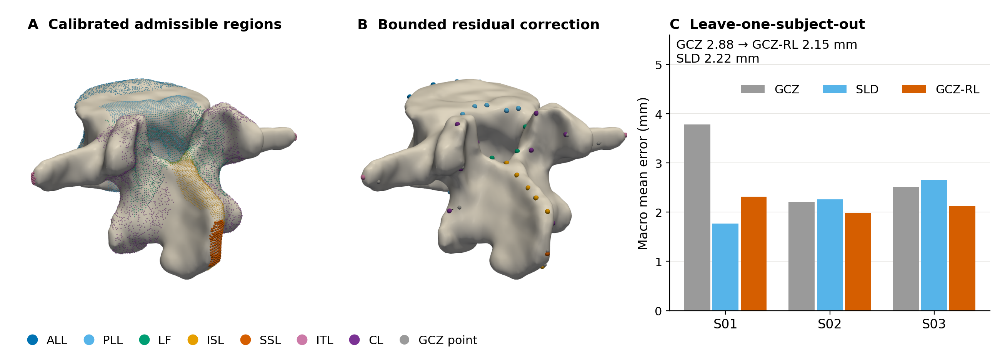

# GCZ-RL: Geometry-Calibrated Residual Learning for Spinal Ligament Landmarks

Code, trained models, predictions, and reproducibility scripts for the manuscript

> M. Ahmadi, M. Lin, Y. Tang, F. D. Vrionis. *Geometry-Calibrated Residual Learning for
> Anatomy-Constrained Spinal Ligament Landmark Reconstruction on Vertebral Surface Meshes.*
> Submitted to *Medical Image Analysis* (2026).

GCZ-RL localizes sparse ligament attachment landmarks (ALL, PLL, LF, ISL, SSL, ITL, CL) on
vertebral surface meshes. It works in three steps:

1. **Calibrated regions.** It learns ligament-specific admissible regions from expert
   annotations in normalized vertebral coordinates (geometry-calibrated zoning, GCZ).
2. **Atlas transfer.** It transfers an annotated atlas by rigid ICP and snaps the transferred
   landmarks into these regions.
3. **Bounded correction.** It corrects each landmark with a bounded Extra Trees residual and
   projects it back onto its region.

Every output is a mesh vertex at an anatomically admissible site.



## Main results

Primary evaluation: patient-level leave-one-subject-out on all 14 lumbar vertebrae of three
subjects. Calibration, atlas, residual targets, correction bounds and model selection are all
nested inside the training subjects.

| Method | MAE (mm) | Pass@5 (%) | Closest point P→R (mm) |
|---|---|---|---|
| GCZ (geometry only) | 2.879 | 86.0 | 2.873 |
| SLD (released code, same evaluator) | 2.224 | 90.4 | 1.787 |
| **GCZ-RL** | **2.150** | **92.7** | 2.140 |

- **GCZ-RL vs GCZ.** Difference −0.729 mm, 95% vertebra-level bootstrap CI −1.078 to −0.381;
  Wilcoxon p < 0.001. Every held-out subject improved.
- **GCZ-RL vs SLD.** Difference −0.074 mm, CI −0.386 to 0.228; p = 0.35, not significant.

MAE is the mean Euclidean distance after one-to-one Hungarian matching. Pass@5 is averaged
over vertebra–class cases.

A supplementary vertebra-wise development analysis (57 vertebrae, cervical to lumbar) is in
`part1_dissertation_57/`.

## Repository layout

```
code/ligament/            method and evaluation (gcz.py, gczrl.py, metrics.py, data_io.py, sld_official.py)
code/third_party/         3D Slicer stub for running SLD outside Slicer; SpineLib is fetched, not stored
code/verify_all.py        independent re-computation of the reported metrics (9 checks)
dataset/                  split, subject codes, checksums, source manifest; raw data are fetched
part1_dissertation_57/    development analysis (20 calibration / 37 held-out vertebrae)
part2_patient_loso_14/    primary analysis: patient-level LOSO, leakage test
paper/                    scripts for every number, table and figure added for the journal paper
scripts/                  fetch_data.py, fetch_spinelib.py
docs/                     PAPER_MAP.md (paper item -> script -> output), CODE_PAPER_AUDIT.md
```

## Installation

Python 3.11 is required, and the versions in `requirements.txt` are pinned.

```bash
python -m venv .venv
.venv/bin/pip install -r requirements.txt      # Windows: .venv\Scripts\pip install -r requirements.txt
```

## Data

The vertebral meshes and expert ligament annotations were published by the SLD authors in the
[SpineToolkit](https://github.com/VisSim-UniKO/SpineToolkit) repository, and are based on VerSe CT
data. That repository has no licence file, so this project **does not redistribute** them.
Instead, one command downloads them from a pinned commit, rebuilds the exact input layout, and
verifies all 1678 files against the checksums of the files used for the paper:

```bash
python scripts/fetch_data.py                        # -> dataset/raw (about 200 MB)
python scripts/fetch_data.py --out D:/gczrl_raw     # elsewhere; then set GCZRL_RAW_ROOT=D:/gczrl_raw
```

On Windows, use `--out` with a short path if the repository sits in a deep folder (the 260-character
path limit). See [dataset/README.md](dataset/README.md) for the subject mapping and the provenance of every file.

## Reproduce the paper

```bash
python part2_patient_loso_14/run_part2.py          # primary LOSO (Tables 4-5), minutes with stored ICP results
python part2_patient_loso_14/run_leakage_test.py   # data-leakage test
python part1_dissertation_57/run_part1.py          # development analysis (Table 6)
python code/verify_all.py                          # independent checks -> VERIFICATION_REPORT.json
python paper/make_paper_numbers.py                 # statistics, Supplementary S2-S4; checks every quoted value
python paper/table3_regressor_comparison.py        # Table 3 and Supplementary Table S6 (about 25 min)
python paper/fig6_qualitative_loso.py              # Fig. 6
python paper/check_fig6.py                         # Fig. 6 points = saved predictions; caption numbers
python paper/graphical_abstract.py                 # graphical abstract
```

Or run everything with `powershell -ExecutionPolicy Bypass -File RUN_ALL.ps1` on Windows, or
`bash run_all.sh` elsewhere.

`--fresh` recomputes the stored ICP geometry and, for Part 2, the SLD output. SLD needs the
SpineLib files, which you fetch with `python scripts/fetch_spinelib.py`.

> **Reproducibility note.** With the stored ICP alignments (the default), every number in the
> paper is regenerated exactly from the public data. This was verified from a clean download.
> Recomputing the alignments with `--fresh` is deterministic within one environment, but it can
> select a different atlas vertebra for individual targets in a different environment.
>
> In a second environment, 2 of the 14 held-out vertebrae changed atlas. The result was
> GCZ 3.208 mm and GCZ-RL 2.418 mm, against 2.879 and 2.150 mm in the paper; SLD was
> unchanged. See Supplementary Section S5 and [docs/CODE_PAPER_AUDIT.md](docs/CODE_PAPER_AUDIT.md).

[docs/PAPER_MAP.md](docs/PAPER_MAP.md) lists, for every table and figure of the paper, the
script that produces it and its output file.

## Notes on the evaluation

- **Matched-point metrics.** The reference annotations are dense point sets, while GCZ and
  GCZ-RL output at most ten landmarks per class. MAE and Pass@5 therefore score matched points
  only. Point coverage and matching-independent metrics are reported alongside them
  (Supplementary Tables S2–S3).
- **SLD.** SLD is run from its released SpineLib code outside 3D Slicer. The VMTK centerline is
  replaced by a documented cross-section approximation
  (`code/third_party/slicer_stub/ExtractCenterline.py`). The SLD numbers refer to this
  implementation.
- **Post hoc constraint.** The left/right side constraint for ITL and CL in the primary analysis
  was introduced after an earlier run had been inspected; this is disclosed in the paper.
- **Audit.** [docs/CODE_PAPER_AUDIT.md](docs/CODE_PAPER_AUDIT.md) records the code-versus-manuscript
  audit done before submission, including one corrected bug in the development regressor
  comparison.

## Citation

See [CITATION.cff](CITATION.cff). Please also cite SLD (Blomenkamp et al., ISBI 2026) and VerSe
(Sekuboyina et al., Med. Image Anal. 2021) when you use the data.

## Licence

The code in this repository is released under the MIT licence ([LICENSE](LICENSE)). The licence
does not cover the source data or SpineLib, which remain under the terms of their owners.
